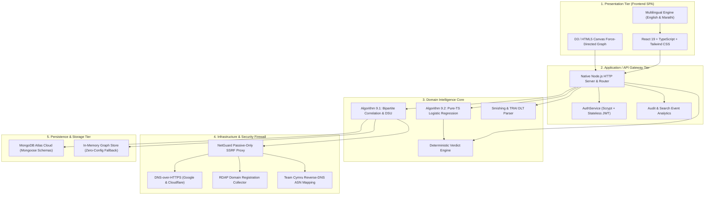

# 🔍 OSINT Fraud Intelligence Framework — Codebase Walkthrough & Examiner Guide

> **Target Audience:** Academic Examiners, Project Evaluators, Researchers, and Developers with Basic Coding Knowledge.  
> **Key Goal:** Explain what every layer, folder, and critical line of code does in plain, accessible language so anyone can evaluate, verify, and understand this cybersecurity project.

---

## 📑 Table of Contents

1. [Executive Summary & Purpose](#1-executive-summary--purpose)
2. [High-Level 5-Tier Architecture](#2-high-level-5-tier-architecture)
3. [Repository Directory & File Map](#3-repository-directory--file-map)
4. [Deep Dive into Core Algorithms](#4-deep-dive-into-core-algorithms)
   - [Algorithm 9.1: Bipartite Graph Syndicate Correlation](#algorithm-91-bipartite-graph-syndicate-correlation)
   - [Algorithm 9.2: Pure-TypeScript Logistic Regression ML](#algorithm-92-pure-typescript-logistic-regression-ml)
   - [Indian TRAI DLT Header & Smishing NLP Engine](#indian-trai-dlt-header--smishing-nlp-engine)
   - [NetGuard Passive-Only SSRF Firewall](#netguard-passive-only-ssrf-firewall)
5. [Application Startup Lifecycle (Step-by-Step)](#5-application-startup-lifecycle-step-by-step)
6. [Interactive Live Demonstration & Viva Cheat-Sheet](#6-interactive-live-demonstration--viva-cheat-sheet)

---

## 1. Executive Summary & Purpose

Modern cyber fraud operations (such as **Electricity Bill Disconnection Scams**, **Fake SBI/HDFC KYC Alerts**, **Part-Time Task Lures**, and **Investment Fraud**) do not operate as isolated web pages. They operate as **organized syndicates** managing infrastructure across multiple vectors:

- **Phishing Domains** (e.g., `sbi-kyc-update.top`)
- **SMS / WhatsApp Messages** with urgency-inducing coercion lures
- **Mule Bank Accounts & UPI IDs** (e.g., `refund@okaxis`)
- **Crypto Mule Wallets** (Bitcoin co-spending clusters)
- **Malicious Android APKs** (Trojanized fake bank apps)

### The Core Problem
Traditional cybersecurity tools evaluate each indicator in isolation. If a new scam domain was registered 2 hours ago, it will not appear on any commercial blocklist.

### Our Solution
This framework discovers **shared underlying infrastructure** (nameservers, SSL certificates, registrar accounts, hosting ASNs, and crypto co-spending inputs) using a **Bipartite Graph Correlation Engine**. If a new domain shares a bulletproof nameserver with 15 known scam sites, it is instantly attributed to that syndicate ring.

---

## 2. High-Level 5-Tier Architecture

The system follows a strict **Clean Architecture / Domain-Driven Design (DDD)** pattern. Dependencies point inward: the domain algorithms have **zero external runtime dependencies**, ensuring 100% auditable TypeScript logic.



---

## 3. Repository Directory & File Map

| Path | Purpose & Functionality |
| :--- | :--- |
| [`backend/src/server.ts`](file:///d:/PersonalProjects/PersonalProjects/wip-osint/osint-fraud-framework/backend/src/server.ts) | **Main Server Entry Point**: Orchestrates the 8-step application lifecycle, dependency injection container, database connection, demo mode seeding, HTTP routes, and background threat feed refresh schedules. |
| [`backend/src/config.ts`](file:///d:/PersonalProjects/PersonalProjects/wip-osint/osint-fraud-framework/backend/src/config.ts) | **Configuration & Environment**: Built-in zero-dependency `.env` parser, configuration schema, and the strict `allowedHosts` whitelist for the SSRF firewall. |
| [`backend/src/domain/correlate.ts`](file:///d:/PersonalProjects/PersonalProjects/wip-osint/osint-fraud-framework/backend/src/domain/correlate.ts) | **Syndicate Clustering Engine (Algorithm 9.1)**: Projects bipartite graphs into asset-asset links, applies logarithmic specificity penalties, combines probabilities via Noisy-OR, and clusters syndicates using Union-Find (DSU). |
| [`backend/src/domain/ml/logistic.ts`](file:///d:/PersonalProjects/PersonalProjects/wip-osint/osint-fraud-framework/backend/src/domain/ml/logistic.ts) | **Pure-TypeScript Logistic Regression (Algorithm 9.2)**: Custom gradient descent optimizer with L2 Ridge regularization, Z-score feature standardization, class-weighted cross-entropy loss, and Mann-Whitney U test for ROC-AUC evaluation. |
| [`backend/src/domain/ml/features.ts`](file:///d:/PersonalProjects/PersonalProjects/wip-osint/osint-fraud-framework/backend/src/domain/ml/features.ts) | **Lexical Feature Extraction**: Computes 13 domain features including Shannon Entropy ($H = -\sum p \log_2 p$), Levenshtein brand similarity, burner TLD flags, and vowel-to-consonant ratios. |
| [`backend/src/domain/smishing.ts`](file:///d:/PersonalProjects/PersonalProjects/wip-osint/osint-fraud-framework/backend/src/domain/smishing.ts) | **SMS / WhatsApp Fraud Parser**: Multi-vector regex extraction (URLs, Indian phone numbers, UPI VPA handles, emails), TRAI DLT header legitimacy scoring, and urgency keyword matching. |
| [`backend/src/domain/detect.ts`](file:///d:/PersonalProjects/PersonalProjects/wip-osint/osint-fraud-framework/backend/src/domain/detect.ts) | **Indicator Type Auto-Detector**: Automatically classifies search queries as domains, IPv4 addresses, emails, phone numbers, Bitcoin wallets, Ethereum wallets, or APK SHA-256 hashes. |
| [`backend/src/domain/assess.ts`](file:///d:/PersonalProjects/PersonalProjects/wip-osint/osint-fraud-framework/backend/src/domain/assess.ts) | **Deterministic Verdict Generator**: Plain-language risk scoring (`official`, `high`, `suspicious`, `info`, `none`), contagion peer risk propagation (+35 points), and safe platform capping. |
| [`backend/src/infrastructure/net-guard.ts`](file:///d:/PersonalProjects/PersonalProjects/wip-osint/osint-fraud-framework/backend/src/infrastructure/net-guard.ts) | **Passive-Only SSRF Firewall**: Enforces strict domain whitelisting, blocks private IP ranges (RFC 1918), inspects redirect hops, and guarantees the investigator's server never touches suspicious targets. |
| [`backend/src/infrastructure/collectors/doh.ts`](file:///d:/PersonalProjects/PersonalProjects/wip-osint/osint-fraud-framework/backend/src/infrastructure/collectors/doh.ts) | **DNS-over-HTTPS & Team Cymru ASN**: Stealthy recursive DNS queries via Google and Cloudflare, plus reverse DNS TXT queries to Team Cymru for hosting provider (ASN) attribution. |
| [`backend/src/infrastructure/collectors/rdap.ts`](file:///d:/PersonalProjects/PersonalProjects/wip-osint/osint-fraud-framework/backend/src/infrastructure/collectors/rdap.ts) | **RDAP Domain Collector**: Queries public registry bootstrap endpoints (RFC 7480-7484) to extract registrar identities, nameservers, and creation dates without using legacy WHOIS. |
| [`backend/src/application/InvestigationService.ts`](file:///d:/PersonalProjects/PersonalProjects/wip-osint/osint-fraud-framework/backend/src/application/InvestigationService.ts) | **Investigation Orchestrator**: Executes the 5-phase forensic query pipeline: query resolution, seed asset expansion, bipartite traversal, linking infrastructure pruning, and plain-language evidence assembly. |
| [`backend/src/application/AuthService.ts`](file:///d:/PersonalProjects/PersonalProjects/wip-osint/osint-fraud-framework/backend/src/application/AuthService.ts) | **Authentication & Security Service**: Scrypt password hashing, timing-attack mitigation (constant-time verification using dummy hash), brute-force rate limiting, and stateless JWT management with instant revocation. |
| [`backend/src/infrastructure/mongo/models.ts`](file:///d:/PersonalProjects/PersonalProjects/wip-osint/osint-fraud-framework/backend/src/infrastructure/mongo/models.ts) | **Mongoose Data Models**: High-performance MongoDB schemas with compound directional indexes, TTL indexes for automatic token cleanup, and audit logs. |
| [`backend/src/infrastructure/mongo/MongoGraphStore.ts`](file:///d:/PersonalProjects/PersonalProjects/wip-osint/osint-fraud-framework/backend/src/infrastructure/mongo/MongoGraphStore.ts) | **MongoDB Database Adapter**: Implements `GraphStore` port using unordered bulk writes (`bulkWrite`) and atomic `$setOnInsert` operations with 1,000-item memory chunking. |
| [`frontend/src/api.ts`](file:///d:/PersonalProjects/PersonalProjects/wip-osint/osint-fraud-framework/frontend/src/api.ts) | **Frontend API Gateway**: Centralized HTTP client handling JWT Bearer tokens, passive search proxies, analytics requests, and smishing analysis. |
| [`frontend/src/App.tsx`](file:///d:/PersonalProjects/PersonalProjects/wip-osint/osint-fraud-framework/frontend/src/App.tsx) | **React Root Dashboard**: Single-page application router, session verification guard, split-screen desktop layout, and multilingual context provider. |
| [`frontend/src/components/VerdictCard.tsx`](file:///d:/PersonalProjects/PersonalProjects/wip-osint/osint-fraud-framework/frontend/src/components/VerdictCard.tsx) | **Verdict Card Component**: Renders colored threat badges, plain-language risk rationales, target brand names, and mandatory security disclaimers. |
| [`frontend/src/components/GraphView.tsx`](file:///d:/PersonalProjects/PersonalProjects/wip-osint/osint-fraud-framework/frontend/src/components/GraphView.tsx) | **Force-Directed Graph Canvas**: Interactive D3 / HTML5 Canvas visualization rendering threat asset nodes, shared infrastructure hubs, threat rings, and real-time physics simulations. |

---

## 4. Deep Dive into Core Algorithms

### Algorithm 9.1: Bipartite Graph Syndicate Correlation
Located in [`backend/src/domain/correlate.ts`](file:///d:/PersonalProjects/PersonalProjects/wip-osint/osint-fraud-framework/backend/src/domain/correlate.ts).

The graph correlation engine operates in 4 mathematical stages:

1. **Bipartite Projection**:
   The database contains two disjoint sets of nodes:
   - **Primary Assets ($V_{asset}$)**: Domains, Phones, Wallets, APKs.
   - **Shared Infrastructure ($V_{infra}$)**: Nameservers, IPs, SSL Certs, Registrars.
   If Asset $A$ and Asset $B$ both connect to Infrastructure $I$, an edge is projected between $A$ and $B$.

2. **Logarithmic Specificity Penalty**:
   Shared infrastructure does not carry equal evidential weight. A private bulletproof nameserver shared by only 3 domains is strong evidence of a shared actor, whereas Cloudflare nameservers shared by 50,000 domains provide almost zero evidence. We apply a logarithmic dampening penalty based on in-degree $Deg(I)$:
   $$\text{Spec}(I) = \frac{1}{1 + K \cdot \ln(Deg(I))}$$
   Where $K = 0.65$. If $Deg(I) > 60$ (a shared public hub), it is completely discarded.

3. **Noisy-OR Probabilistic Combination**:
   When two assets share multiple pieces of infrastructure (e.g., both share an IP and an SSL certificate), their independent confidence scores $c_1, c_2, \dots, c_m$ are combined using the Noisy-OR model:
   $$C(A, B) = 1 - \prod_{i=1}^m (1 - c_i)$$
   This ensures that evidence compounds monotonically: multiple weak links legitimately combine into high syndicate confidence.

4. **Union-Find / Disjoint Set Union (DSU)**:
   Pairs with $C(A, B) \ge 0.35$ are merged into syndicate clusters using Union-Find with **Path Compression** and **Union by Rank**, executing in near-linear $\mathcal{O}(\alpha(N))$ time.

---

### Algorithm 9.2: Pure-TypeScript Logistic Regression ML
Located in [`backend/src/domain/ml/logistic.ts`](file:///d:/PersonalProjects/PersonalProjects/wip-osint/osint-fraud-framework/backend/src/domain/ml/logistic.ts).

Rather than calling external Python microservices or heavy C++ bindings, the system includes a complete, mathematically rigorous machine learning implementation written directly in TypeScript:

1. **13 Lexical Domain Features** ([`features.ts`](file:///d:/PersonalProjects/PersonalProjects/wip-osint/osint-fraud-framework/backend/src/domain/ml/features.ts)):
   - Shannon Entropy: Measures randomness of characters ($H = -\sum p_i \log_2 p_i$).
   - Normalized Levenshtein Distance to trusted banking and telecom brands.
   - Cheap/Burner TLD indicators (`.top`, `.xyz`, `.club`, `.work`).
   - Digit count, hyphen count, and vowel-to-consonant ratios.

2. **Z-Score Feature Standardization**:
   Features are normalized to zero mean and unit variance ($\mu=0, \sigma=1$) to prevent features with large ranges from dominating gradient updates:
   $$z = \frac{x - \mu}{\sigma}$$

3. **Sigmoid Hypothesis**:
   Maps raw linear combinations $z = \mathbf{w}^T \mathbf{x} + b$ to a probability in the range $[0, 1]$:
   $$\sigma(z) = \frac{1}{1 + e^{-z}}$$

4. **Class-Weighted Cross-Entropy Loss with L2 Ridge Regularization**:
   Handles class imbalance (malicious domains are typically rarer than benign domains):
   $$\mathcal{L} = -\frac{1}{N} \sum_{i=1}^N \left[ w_{pos} \cdot y_i \ln(\hat{y}_i) + w_{neg} \cdot (1 - y_i) \ln(1 - \hat{y}_i) \right] + \frac{\lambda}{2} \|\mathbf{w}\|_2^2$$

5. **Mann-Whitney U Test for ROC-AUC**:
   Calculates exact Area Under the ROC Curve without approximations by computing the probability that a randomly chosen positive sample scores higher than a negative sample.

---

### Indian TRAI DLT Header & Smishing NLP Engine
Located in [`backend/src/domain/smishing.ts`](file:///d:/PersonalProjects/PersonalProjects/wip-osint/osint-fraud-framework/backend/src/domain/smishing.ts).

SMS fraud in India is governed by the Telecom Regulatory Authority of India (TRAI) Distributed Ledger Technology (DLT) regulations:

1. **Alphanumeric Sender Header Validation**:
   - Legitimate transactional SMS headers follow the format `XX-YYYYYY` (e.g. `VM-HDFCBK` or `AD-SBIINB`), where the first 2 letters denote the telecom circle/operator, followed by a registered 6-character brand identifier.
   - If an SMS claims to be from "SBI Bank" but originates from a personal 10-digit mobile number (`+919876543210`) or an unregistered VoIP number, it is heavily penalized.

2. **Psychological Coercion Detection**:
   The engine scans for high-pressure urgency triggers:
   - *Time Windows:* "tonight at 9:30 PM", "within 24 hours", "immediately".
   - *Threat Actions:* "power will be disconnected", "electricity office", "account suspended", "KYC expired", "PAN blocked".
   - *Greed/Lure Triggers:* "part-time job", "earn Rs 5000 daily", "YouTube review bonus".

3. **Multi-Vector Indicator Extraction**:
   Automatically parses nested URLs, callback phone numbers, and UPI handles embedded in the SMS text and links them directly into the graph investigation engine.

---

### NetGuard Passive-Only SSRF Firewall
Located in [`backend/src/infrastructure/net-guard.ts`](file:///d:/PersonalProjects/PersonalProjects/wip-osint/osint-fraud-framework/backend/src/infrastructure/net-guard.ts).

To ensure complete operational security during investigations:
- **Zero Contact with Target:** Outbound HTTP requests to suspect domains are strictly forbidden.
- **Strict Host Whitelist:** Outbound requests are allowed *only* to verified public intelligence APIs (Google DoH, Cloudflare DoH, RDAP.org, Team Cymru, Blockchair, URLhaus).
- **Private IP & Loopback Blocking:** Any request resolving to `127.0.0.1`, `10.0.0.0/8`, `192.168.0.0/16`, or link-local cloud metadata endpoints (`169.254.169.254`) is immediately aborted to prevent Server-Side Request Forgery (SSRF).
- **Redirect Hop Inspection:** If an allowed host redirects to an unapproved destination, NetGuard intercepts and blocks the hop.

---

## 5. Application Startup Lifecycle (Step-by-Step)

When running `npm start` in `backend/`, [`backend/src/server.ts`](file:///d:/PersonalProjects/PersonalProjects/wip-osint/osint-fraud-framework/backend/src/server.ts) executes the following 8-step lifecycle:

```
[Server Startup Lifecycle]
  │
  ├─► STEP 1: Parse Configuration (.env file or defaults)
  │
  ├─► STEP 2: Initialize Storage Adapter
  │            ├─► MongoDB Atlas (if MONGODB_URI is provided)
  │            └─► MemoryGraphStore (zero-config standalone fallback)
  │
  ├─► STEP 3: Wire Application Services (Dependency Injection Container)
  │            ├─► AuthService, InvestigationService, AssessmentService, MLService
  │
  ├─► STEP 4: Seed Demo Intelligence Data (if graph is currently empty)
  │            ├─► Seeds electricity scam syndicates, fake SBI KYC clusters, etc.
  │
  ├─► STEP 5: Warm Up Machine Learning Model
  │            ├─► Loads trained model from MongoDB, or trains demo model
  │
  ├─► STEP 6: Bind HTTP API Routes & CORS
  │            ├─► /api/search, /api/auth/*, /api/message/analyze, /api/model/*
  │
  ├─► STEP 7: Start Background Cron Scheduler
  │            ├─► Periodically syncs URLhaus/OpenPhish threat feeds & runs correlation
  │
  └─► STEP 8: Register Graceful Shutdown Handlers (SIGINT/SIGTERM)
```

---

## 6. Interactive Live Demonstration & Viva Cheat-Sheet

During your practical viva examination or live project evaluation, use these sample scenarios to demonstrate the full power of the system:

### Demo Scenario 1: Investigating a Phishing Domain
1. Log in to the dashboard using your registered credentials, or click the **⚡ Quick Admin Access** button.
2. Enter this domain in the search box:
   ```
   sbi-pan-kyc.xyz
   ```
3. **What to highlight to the examiner:**
   - **Verdict Card:** Highlight the red **HIGH RISK** badge. Explain that the domain was caught both by the typosquat detector (Levenshtein distance to `sbi`) and the active blocklist.
   - **Explainability List:** Point out the exact bullet points explaining *why* it is flagged.
   - **Interactive Graph:** Point to the red threat ring. Show how clicking on connected nodes pivots to the hosting IP and nameserver.

---

### Demo Scenario 2: Analyzing a Telecom Smishing Scam
1. Click on the **💬 Smishing** tab on the top navigation bar.
2. Select the pre-loaded **⚡ Electricity Disconnect Scam** sample:
   > *"Dear consumer, your electricity power will be disconnected tonight at 9:30 PM from the electricity office because your previous month bill was not updated. Please immediately update your bill or contact our electricity officer at +919876543210 or visit https://bill-mahadiscom-pay.top to avoid disconnection."*
3. Click **Analyze Message**.
4. **What to highlight to the examiner:**
   - **Urgency Meter:** The framework flags extreme psychological urgency ("tonight at 9:30 PM", "disconnected").
   - **Indicator Extraction:** It automatically pulled out the fake phone number `+919876543210` and the malicious domain `bill-mahadiscom-pay.top`.
   - **One-Click Pivot:** Click the "Investigate" button next to the extracted domain to immediately jump into the graph map.

---

### Demo Scenario 3: Legitimate / Official Domain Verification
1. Search a genuine official domain:
   ```
   sbi.co.in
   ```
2. **What to highlight to the examiner:**
   - **Official Badge:** The card displays a green **OFFICIAL: SBI** verdict.
   - **Security Guarantee:** Official domains of legitimate registered brands can never be accidentally marked as malicious or typosquats, preventing costly false positives.

---

### Demo Scenario 4: Multilingual Support (English & Marathi)
1. In the top right corner of the navigation bar, click the language dropdown and select **मराठी (Marathi)**.
2. **What to highlight to the examiner:**
   - The entire dashboard, verdict cards, graph legends, and forensic explanations switch seamlessly into Devanagari Marathi script.
   - This proves the system is ready for deployment across Indian law enforcement agencies and state police cyber cells (e.g., Maharashtra Cyber Police).

---

### Demo Scenario 5: Retraining the Pure-TypeScript ML Model
1. Go to the **⚙️ Admin** tab (visible to administrator accounts).
2. Look at the **Machine Learning** card:
   - Point out the pure-TypeScript Logistic Regression model with 13 lexical domain features.
   - Show the **ROC-AUC Score** (e.g. `0.985`), proving high discriminative accuracy.
3. Click **Retrain Model**:
   - The system re-standardizes domain features, runs gradient descent, recalculates ROC-AUC, and persists the new weights to MongoDB Atlas in real-time.

---

## 7. Verification & Test Suite

The entire framework has an automated test suite verifying all 49 contracts across backend and frontend:

```bash
# Run complete test suite across backend and frontend
npm test
```

**Test Coverage Highlights:**
- `scrypt` password hashing and timing attack resistance.
- Stateless JWT verification, tampering rejection, and revocation lists.
- Bipartite correlation, specific penalty dampening, and DSU clustering.
- Pure-TypeScript Logistic Regression, sigmoid math, and ROC-AUC calculation.
- SSRF NetGuard firewall IP blocking and redirect inspection.
- English and Marathi translation parity.

---

*Authored for Academic Examination & Project Evaluation.*
